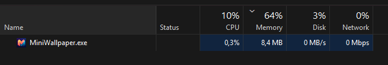
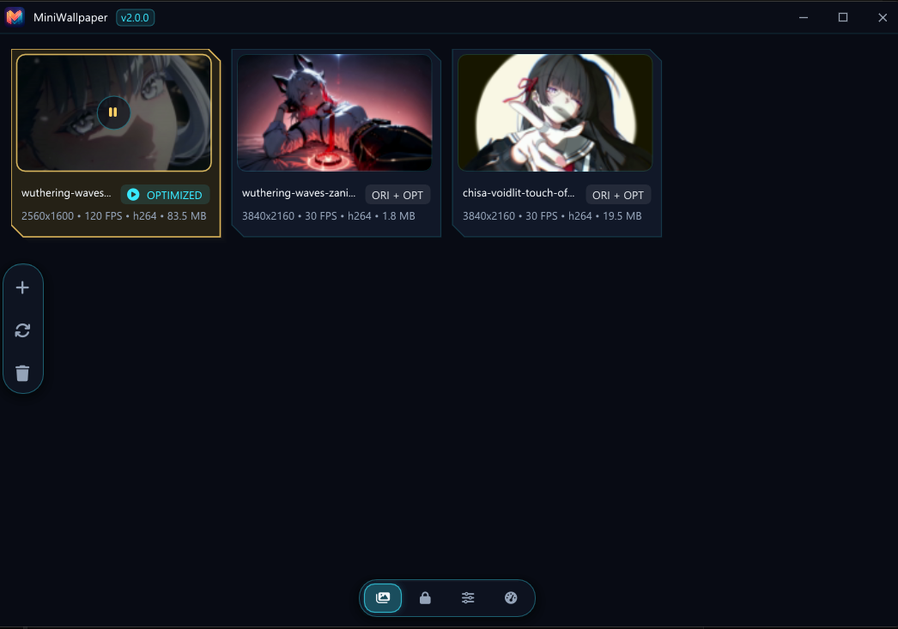
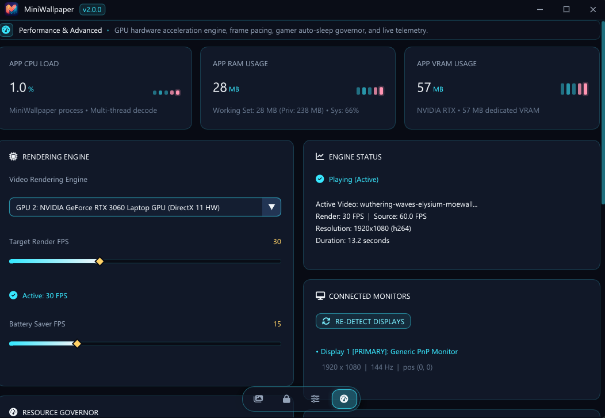

<div align="center">

  

  # MiniWallpaper

  **Ultra-Lightweight, High-Performance Animated Video Wallpaper Engine for Windows**

  [](https://github.com/f4rdani/LiteWallpaper/releases/tag/v2.0.0)
  [](LICENSE)
  [](https://en.wikipedia.org/wiki/C%2B%2B20)
  [](https://learn.microsoft.com/windows/win32/direct3d11/direct3d-11-graphics)
  [](https://microsoft.com/windows)
  []()
  []()

  <p align="center">
    <i>Experience breathtaking live video wallpapers with virtually <b>zero impact</b> on system resources, battery life, and gaming performance.</i>
  </p>

</div>

---

## ⚡ Performance Benchmarks (v2.0.0)

MiniWallpaper is engineered in native **C++20** and **DirectX 11 (D3D11VA)** from the ground up, completely eliminating heavy web runtimes (Chromium/CEF/Electron/WPF) to achieve an unprecedented low-resource footprint:

| Operational Metric | 🚀 **MiniWallpaper (v2.0.0)** | State / Verification Details |
| :--- | :---: | :--- |
| **RAM (Task Manager "Memory")** | **`6 MB - 10 MB`** | 1920×1080 @ 60 fps hardware playback, adaptive working-set trim (median 8.3 MB) — scales with the resolution of the video you pick |
| **RAM (Deep Suspend / Idle)** | **`< 1.0 MB`** | Decoder fully released + automatic working-set trim |
| **CPU Usage** | **`0.0% - 1.0%`** (avg `~0.3%`) | Decoded entirely on GPU hardware ASIC (NVDEC / Intel QSV) |
| **Dedicated VRAM** | **`~50 MB - 61 MB`** | Optimized 4–6 surface pool (drops to 0 MB on pause) |
| **3D Graphics Core Load** | **`~3.0%`** | 3D rendering cores remain ~97% free for games |
| **dGPU Power Saving** | 🟢 **Deep Sleep (0% dGPU load)** | Automatic routing to iGPU or deep suspend during gaming |
| **Process Architecture** | **Native C++20 / Direct3D 11** | Zero external runtime dependencies, pure Win32 |

> Verified on the live daemon (1920×1080 @ 60 fps hardware decode, October 2026). *Memory* = Task Manager's private working set: **5.4–10 MB while playing** with the adaptive working-set trim (median 8.3 MB; brief <1 s warm-up spikes), **< 1 MB in deep sleep**, ~5 MB in deep sleep with the control panel open.

> 📐 **Resolution matters:** every number above is measured with a **1080p (1920×1080)** wallpaper. RAM, VRAM and GPU load scale with the **resolution and FPS of the video you choose** — a 4K source decodes ~4× the pixels. That is exactly why the built-in one-click **GPU Optimizer (4K → 1080p)** exists: it brings heavy videos down into the footprint above.

### 📸 Real-World Telemetry

#### 1. Windows Task Manager Footprint
> *MiniWallpaper running with active 1080p hardware-accelerated video playback at only **8.4 MB RAM** and **0.3% CPU** (Task Manager, control panel closed):*

<div align="center">
  
</div>

### 🖥️ Control Panel UI

#### 1. Wallpaper Gallery
> *Drag & drop videos, run the one-click GPU Optimizer (4K → 1080p), and play/pause instantly from YouTube-style gallery cards with per-video codec/FPS/bitrate tooltips:*

<div align="center">
  
</div>

#### 2. Performance & Advanced
> *Live CPU / RAM / VRAM telemetry, render engine and frame-pacing controls, connected-monitor overview, and the Gaming Auto-Sleep resource governor:*

<div align="center">
  
</div>

---

## ✨ Key Features

- 🎬 **Universal Video Playback**: High-efficiency hardware decoding for MP4, WebM, MKV, AVI, and MOV via FFmpeg D3D11VA (H.264 / HEVC / AV1 / VP9).
- 🔋 **Smart Dual-GPU Power Routing**: Automatically renders on the energy-efficient **Integrated GPU (iGPU / Intel UHD / AMD APU)**, leaving discrete NVIDIA/AMD gaming GPUs in complete deep sleep (0% load).
- 🎮 **Intelligent Power Governor**:
  - **Auto-Pause on Fullscreen**: Automatically suspends playback and video decoding when a fullscreen game or application is active.
  - **Smart Resource Governor (Gaming & Heavy Load Sleep)**: Automatically puts wallpaper into Deep Sleep (0% CPU, 0 MB VRAM) when overall system RAM or GPU VRAM reaches threshold (e.g. $\ge 80\%$) during windowed gaming, and auto-resumes when memory pressure drops.
  - **Battery Saver Mode**: Dynamically reduces frame rates or pauses when running on laptop battery.
  - **Workstation Lock Detection**: Instantly sleeps when Windows is locked (`Win + L`) to preserve power.
- 🖼️ **Dual Independent Static Wallpapers**: Set separate static snapshot sources and custom extracted frames for Windows Desktop and Lock Screen independently.
- 🎯 **Frame-Accurate Timestamp & Frame Picker**: Seek with frame-precision across 120+ FPS videos with real-time dynamic slider preview modal.
- 🌙 **Native Windows Screensaver (`MiniWallpaper.scr`)**: Seamless companion screensaver binary that plays your animated wallpapers when idle.
- 🎨 **Modern Control Panel & Translucent UI**: 4-tab responsive layout, YouTube-style gallery cards with resolution tooltips, and acrylic-style translucent glass window backdrop.
- ⚡ **Integrated 1080p Video Optimizer**: Built-in GPU pre-scaler that converts heavy 4K/high-bitrate videos into lightweight 1080p NV12 hardware streams, saving up to ~75% GPU load.
- 🖥️ **Multi-Monitor & Desktop Selection**: Choose whether wallpapers play across all monitors or selectively target specific screens.
- 🚀 **Ultra-Low Memory Footprint**: Tuned mimalloc zero-purge, single-buffered streaming and an adaptive working-set trim keeping Task Manager memory in the 6-10 MB band while playing (< 1 MB in deep sleep).

---

## 🚀 How to Use

> 🇬🇧 **English** · 🇮🇩 [**Bahasa Indonesia**](#-cara-pakai)

### Step 1 — Download & extract
1. Download the latest portable zip (`MiniWallpaper-Portable-…-win64.zip`) from the [**Releases page**](https://github.com/f4rdani/LiteWallpaper/releases/latest).
2. Extract the **whole zip** into any folder you like (e.g. `D:\MiniWallpaper\`).
   > ⚠️ Keep all files together — `MiniWallpaper.exe` needs the DLL files and the `assets` folder sitting next to it. Don't move the exe out on its own.

### Step 2 — First launch
3. Run **`MiniWallpaper.exe`**. A tray icon appears next to the clock — the app is now running.
4. If Windows SmartScreen shows *"Windows protected your PC"* (the app is not code-signed yet), click **More info → Run anyway**.
   > ✅ No installer, no extra downloads — everything the app needs (including the VC++ runtime DLLs) ships inside the zip.

### Step 3 — Add & play a wallpaper
5. **Left-click the tray icon** to open the Control Panel. *(Tip: running `MiniWallpaper.exe` again also opens the panel of the running instance — it never starts a second copy.)*
6. In the **Wallpaper Gallery**, **drag & drop** any video (MP4 / WebM / MKV / AVI / MOV) onto the window — or click the **`+`** button to browse for one. Then press **▶ Play**.
7. *(Optional)* For a heavy 4K video, click the one-click **GPU Optimizer** on its card — it converts the video into a lightweight 1080p stream (saves up to ~75% GPU load).

### Step 4 — Everyday use
- **Close (or minimize) the Control Panel** → it returns to the tray and releases the whole UI stack — the wallpaper keeps playing at only **6–10 MB RAM**.
- **Right-click the tray icon** for the quick menu: `Control Panel` · `Play / Pause` · `Mute / Unmute` · `Change Wallpaper...` · `Exit`.
- **Gaming?** Nothing to configure — MiniWallpaper auto-pauses with a fullscreen game/app and resumes when you return to the desktop.
- **Start with Windows:** Control Panel → **Settings → "Startup & System Tray"** → toggle **"Start MiniWallpaper on Windows Boot"** (off by default).
- **Screensaver (optional):** right-click `MiniWallpaper.scr` → **Install** (or copy it to `C:\Windows\System32`), then pick **MiniWallpaper** in the Windows screen-saver settings.

### Step 5 — Troubleshooting
- **SmartScreen warning** → expected for an unsigned open-source app: click **More info → Run anyway**.
- **Antivirus flags it (false positive)** → verify the file on [VirusTotal](https://www.virustotal.com) or build it yourself from source (everything is in this repo).
- **Uninstall** → disable "Start MiniWallpaper on Windows Boot" in the panel, then simply delete the folder (optionally also remove `%APPDATA%\MiniWallpaper`).

**Requirements:** Windows 7 SP1 / 8 / 10 / 11 (64-bit) · no internet connection needed after download.

---

## 🇮🇩 Cara Pakai

> 🇬🇧 [**English**](#-how-to-use) · 🇮🇩 **Bahasa Indonesia**

### Langkah 1 — Unduh & extract
1. Unduh zip portable terbaru (`MiniWallpaper-Portable-…-win64.zip`) dari [**halaman Releases**](https://github.com/f4rdani/LiteWallpaper/releases/latest).
2. Extract **seluruh isi zip** ke folder mana saja (contoh: `D:\MiniWallpaper\`).
   > ⚠️ Biarkan semua file tetap satu folder — `MiniWallpaper.exe` butuh file DLL dan folder `assets` di sebelahnya. Jangan pindahkan exe-nya sendirian.

### Langkah 2 — Jalankan pertama kali
3. Jalankan **`MiniWallpaper.exe`**. Ikon muncul di system tray (dekat jam) — aplikasi sudah berjalan.
4. Kalau muncul peringatan SmartScreen *"Windows protected your PC"* (wajar — exe belum code-signed), klik **More info → Run anyway**.
   > ✅ Tanpa installer, tanpa install tambahan — semua kebutuhan aplikasi (termasuk DLL VC++ Runtime) sudah dibundel di dalam zip.

### Langkah 3 — Pasang & mainkan wallpaper
5. **Klik kiri ikon tray** untuk membuka Control Panel. *(Tips: menjalankan `MiniWallpaper.exe` lagi juga membuka panel milik instance yang sedang jalan — tidak akan dobel.)*
6. Di **Wallpaper Gallery**, **drag & drop** video apa pun (MP4 / WebM / MKV / AVI / MOV) ke jendela — atau klik tombol **`+`** untuk memilih file. Lalu tekan **▶ Play**.
7. *(Opsional)* Untuk video 4K yang berat, klik **GPU Optimizer** sekali-klik di kartunya — video dikonversi jadi stream 1080p ringan (hemat beban GPU sampai ~75%).

### Langkah 4 — Pemakaian sehari-hari
- **Tutup (atau minimize) Control Panel** → kembali ke tray dan seluruh UI dilepas dari memori — wallpaper tetap jalan hanya dengan **6–10 MB RAM**.
- **Klik kanan ikon tray** untuk menu cepat: `Control Panel` · `Play / Pause` · `Mute / Unmute` · `Change Wallpaper...` · `Exit`.
- **Mau main game?** Tidak perlu setting apa pun — MiniWallpaper auto-pause saat game/aplikasi fullscreen aktif dan lanjut sendiri saat kamu kembali ke desktop.
- **Nyala otomatis saat Windows boot:** Control Panel → **Settings → "Startup & System Tray"** → aktifkan toggle **"Start MiniWallpaper on Windows Boot"** (default: mati).
- **Screensaver (opsional):** klik kanan `MiniWallpaper.scr` → **Install** (atau copy ke `C:\Windows\System32`), lalu pilih **MiniWallpaper** di pengaturan screen saver Windows.

### Langkah 5 — Kalau ada masalah
- **Peringatan SmartScreen** → memang begitu untuk aplikasi open-source yang belum ditandatangani: klik **More info → Run anyway**.
- **Antivirus menandai (false positive)** → verifikasi file-nya di [VirusTotal](https://www.virustotal.com) atau build sendiri dari source (semuanya ada di repo ini).
- **Uninstall** → matikan dulu "Start MiniWallpaper on Windows Boot" di panel, lalu hapus foldernya (opsional: hapus juga `%APPDATA%\MiniWallpaper`).

**Kebutuhan:** Windows 7 SP1 / 8 / 10 / 11 (64-bit) · tidak butuh koneksi internet setelah diunduh.

---

## 🛠️ Building from Source

### Prerequisites
* Windows 7 SP1 or newer (64-bit)
* Visual Studio 2022 / MSVC (C++20 toolset)
* [CMake 3.20+](https://cmake.org/download/)
* [vcpkg](https://github.com/microsoft/vcpkg)
* FFmpeg 64-bit Shared Developer SDK

### Build Steps

```powershell
# 1. Install dependencies via vcpkg
vcpkg install nlohmann-json:x64-windows mimalloc:x64-windows imgui[docking-experimental,win32-binding,dx11-binding]:x64-windows

# 2. Clone repository
git clone https://github.com/f4rdani/LiteWallpaper.git
cd LiteWallpaper

# 3. Configure & Compile (Release Mode)
cmake -B build -S . -DCMAKE_TOOLCHAIN_FILE="C:/vcpkg/scripts/buildsystems/vcpkg.cmake"
cmake --build build --config Release
```

The compiled portable binary will be generated at `build/Release/MiniWallpaper.exe`.

---

## 📖 Architecture & Documentation

For in-depth architectural details, DirectX 11 presentation pipeline, IPC protocol specifications, and contributing guidelines, please refer to **[DEVELOPMENT.md](DEVELOPMENT.md)**.

---

## 📄 License

This project is licensed under the **GNU General Public License v3.0 (GPL-3.0)**. See the [LICENSE](LICENSE) file for more details.
